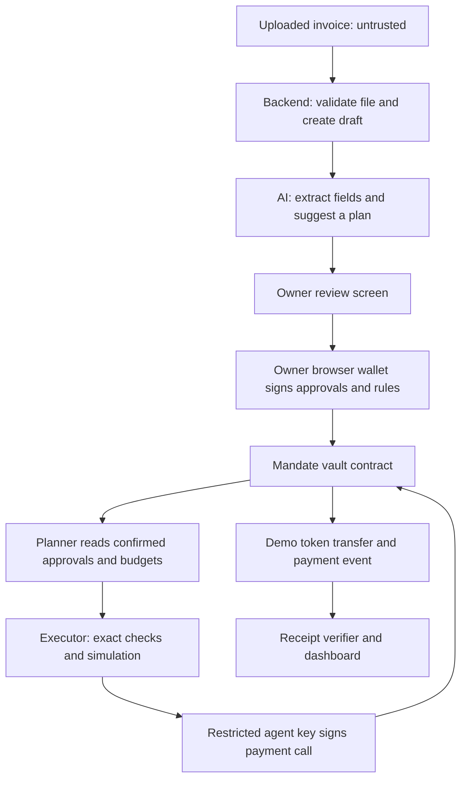

# Mandate architecture

This describes the implemented local core, owner workflow and AI/payment workflow in [PROJECT_PLAN.md](PROJECT_PLAN.md). On 18 October the user chose Gemini and authorized live development checks; [Gemini results](evidence/STEP4_GEMINI_RESULTS.md) record what actually passed and remains. A smart contract checks payment rules even if the AI makes a mistake.

**17 October handoff:** source/design unchanged during documentation cleanup. The app and local chain are stopped. On a new launch, drafts remain but the ephemeral chain, approvals, session ID and in-memory agent key are new; follow the [resume checklist](PROGRESS.md#resume-on-18-october-2026).

## Components and data flow

| Component | Responsibility | Cannot do |
| --- | --- | --- |
| Dashboard | File review, rule setup, owner signing, payment explanations and receipts | Hold owner private keys or treat an unsigned draft as permission |
| Backend and local database | Store drafts, vendor records, chain references, queue and audit records | Replace on-chain payment authority with database flags |
| Model adapter | Extract proposed fields; interpret requests; propose known bill IDs or a focused question/correction | Access keys, approve bills, expand limits, claim payment or create arbitrary transactions |
| Planner and executor | Calculate with integers, order approved bills, check current state, simulate and send restricted calls | Choose a new recipient/amount or silently change owner rules |
| Vault contract | Store approvals and enforce every payment condition | Read PDFs, prove goods were delivered or judge business truth |
| Receipt verifier | Match actual chain events to the intended bill and reconcile pending outcomes | Claim payment from an AI response or an unconfirmed hash |

Implemented contract stack: Solidity 0.8.37 targeting Cancun; OpenZeppelin Contracts 5.6.1 (ERC20, SafeERC20 and storage-based ReentrancyGuard); Forge/Anvil 1.7.1; ethers 6.17.0 for scripted local receipts and identity hashing. npm packages are pinned in package-lock.json. The local prototype is tested with Node 25.2.1/npm 11.6.2. See [run instructions](README.md#run-checks-and-the-contract-demonstration).

Step 3 uses a small Node HTTP service, built-in SQLite and plain browser ES modules/HTML/CSS, bundled with esbuild 0.28.2. This replaces the earlier tentative TypeScript framework choice with a smaller local implementation. csv-parse 7.0.3 reads supported CSV; PDF.js 6.4.299 extracts text in a resource-limited worker. pdf-lib 1.17.1 makes synthetic sample/test bills. Playwright 1.64.1 checks the UI in an isolated Chrome profile. Step 4 adds the modules below without new npm dependencies. No public deployment is present.

## Implemented owner workflow

1. `app/server.mjs` binds to 127.0.0.1, checks Host/Origin/CSRF, serves only built UI assets and exposes bounded intake/owner-review operations. It has no owner-signing endpoint or arbitrary RPC proxy; Step 4 adds only the fixed restricted-payment routes described below.
2. `app/intake.mjs` validates UTF-8 CSV or PDF magic bytes, keeps the original text and document hash, and creates editable drafts. PDFs use exact labeled fields; unfamiliar layouts stay incomplete for manual review. A file is limited to 5 MiB; CSV to 50 rows/200,000 text characters and PDF to 20 pages/200,000 text characters, with a 10-second/128 MiB worker limit.
3. `app/store.mjs` stores documents, versioned drafts/review stamps and transaction intents in local SQLite. Source bytes are discarded after extraction. Draft edits clear review; vendor revision changes and cancellation invalidate affected reviews. Similar IDs require explicit owner acknowledgment; exact duplicates cannot join a new batch.
4. `app/service.mjs` pins chain, vault/token code hashes and owner/token addresses, reads current permission state, validates exact integer fields, simulates only whitelisted owner methods and stores an encoded transaction review. Browser-selected recipients never override the registry.
5. `app/client.mjs` shows source and fields side by side, decodes the actual calldata, checks wallet account/network, validates the prepared version again, then asks an EIP-1193 browser wallet to sign. Rejected, submitted, reverted, unknown and confirmed outcomes remain distinct. Any known hash is persisted before waiting/reconciliation; no automatic resend occurs.
6. Confirmation checks the transaction's chain/sender/destination/value/calldata and matching contract events. A newer draft version cannot inherit an older approval. Editing does not revoke an existing on-chain approval; the UI offers explicit cancellation/replacement and explains that boundary.

The dev launcher starts a separate disposable Anvil chain and seeds configuration using local signers. An optional public owner address is impersonated **only during local setup**, then locked again for browser signing; no owner private key is read. Session IDs prevent approvals from an earlier ephemeral chain instance being reused as current. See [Step 3 evidence](evidence/STEP3_RESULTS.md).

Repository CI on 18 October exposed unused browser TCP preconnections keeping server shutdown open. The server now tracks connections, closes only never-requested sockets during shutdown and lets active HTTP requests finish. `close()` reuses one promise for repeated calls. Two regression checks cover this cleanup; payment permissions and receipt rules are unchanged.

## Implemented agent workflow

1. `app/model.mjs` selects an explicit provider from backend configuration: Gemini Interactions REST (`v1beta`, pinned `gemini-3.8-flash`) or the original optional OpenAI Responses adapter. Native Node fetch sends JSON Schema and `store: false`, without tools, automatic retries or provider/model fallback. Gemini uses low thinking, no thought summaries and a 5,000-token output cap; opaque thought signatures are ignored and never saved. Requests time out after 20 seconds. Only completed single final text responses that pass local shape/type/length checks become proposals. Quota/access/outage errors leave manual review available. Credentials stay in private backend fields and a header, never URLs. Safe model/prompt/latency/token metadata accompany valid proposals. Free eligibility does not establish the API project's billing tier; the owner controls that in AI Studio.
2. `app/agent.mjs` interprets bounded owner messages using bill summaries, a previous clarification and the chain-derived business date in Asia/Dhaka. Source text/notes are excluded from request interpretation. Optional field assistance sends one synthetic invoice's text only after an explicit click. Multiple-invoice CSVs use their separate deterministic records. Corrections are proposals: applying changes only the versioned draft and clears review. The original signed permission is unchanged.
3. `app/planner.mjs` uses integer units and current chain approvals. Ordering is owner priority, due date, stable bill key. It checks approval, vendor, session/window, caps, balance and reserve, then gives a checked reason/action for every entry. Budget projections are snapshots; due dates determine order, while the signed payment window determines when payment is allowed.
4. The UI displays the exact plan and recipients. Read-only/clarification/unsupported proposals cannot execute. A question/preview guard also prevents a model's mistaken `pay` classification gaining send authority. A payment plan needs a separate checked confirmation. A clearly labeled scripted manual preview works when AI is off; no repeated owner signatures are needed for its already-approved batch.
5. `app/executor.mjs` holds only the restricted agent signer. It claims the durable queue, refreshes permissions, draft/approval versions and UTC day, and simulates each fixed `payBill(key,version)` call. It signs that call, computes and stores its hash/nonce **before broadcast**, then verifies the actual chain/sender/destination/calldata and exact payment event. It stops at the first uncertain/reverted/stale outcome. The contract independently checks every payment rule.
6. SQLite retains plans and original payment references. A compare-and-set claim serializes batches across executor objects. Pending/unknown/invalid payment outcomes block new sends. Recovery only reads original hashes; it never broadcasts. A crashed run can be marked interrupted only when its recorded process PID no longer exists. Live/reused PIDs remain locked for investigation. A fresh plan is required after recovery; there is no automatic queue resume or fee replacement.

The local launcher now creates a random separate agent wallet **in memory**, gives it local test ETH and grants its bounded session. It never prints or saves this key. Restarting the entire launcher creates a new chain/session and discards that key; same-chain backend/store recovery is tested separately. This is not public-testnet key management. See [Step 4 results](evidence/STEP4_RESULTS.md).

## Signing boundaries

**Owner:** browser wallet signs deployment/funding, vendor approvals, exact bill batches, policy/session changes, cancellation and revocation. The backend never receives the owner key.

**Agent:** a separate test-only key signs calls to pay already-approved bills. Its ETH balance pays gas. It has no permission to approve bills, move owner-wallet funds, change rules or call arbitrary contracts. The model never receives this key.

**Model:** produces structured proposals referencing known bill IDs. A proposal is neither an owner signature nor a transaction authorization. An original invoice cannot change the tool permissions.

For each request, the backend reads approvals, policy and payment state using fixed calls. The model receives a bounded summary and proposes intent, known bill IDs, a question or a draft correction; it has no tool calls. Ordinary code applies the ordering/arithmetic and creates explanations from checked state and receipts. Read-only or unclear requests cannot start the executor. Changing approved bill fields returns to owner review and signing. Resolve relative dates against the recorded business date and timezone; daily contract limits still use UTC.

## Contract responsibilities

Use one vault and one fixed demo token, MDT with six decimals. Store approved vendor recipients, exact bill approvals with the source-document fingerprint/reference, paid-bill markers, agent identity/expiry, spending limits, reserve, pause state, cumulative daily spending and a policy version.

The implemented [vault](contracts/MandateVault.sol) starts paused. Its owner and token address are immutable; ownership transfer/upgrades are outside this prototype. Constructor checks allow only chain 31337 or Sepolia 11155111 and require a deployed six-decimal token. This decimal check does not authenticate a token: the demo deploys MDT itself, and the app pins that exact deployment's addresses and runtime hashes. Public deployment is still pending.

- Owner-only methods approve/update vendors and unpaid bills, set rules/session, cancel bills and revoke/pause access. Updating any permission increases the policy version; it must not clear spending history or paid markers.
- The payment entry point takes an approved bill key and expected policy version. The contract obtains the destination and amount from stored approval, checks all rules, marks the bill paid, updates spending and transfers the exact token amount in one atomic transaction.
- Checks include agent identity, pause/revocation, payment window, unused bill key, approved recipient, per-bill/daily caps, balance after payment, and current policy version.
- Use guarded token transfers and reentrancy protection. Do not expose arbitrary calls, token approvals or upgrades to the agent.
- Owner recovery is allowed only while paused. Record it as an owner action, separate from agent payments.

`approveBills` accepts up to 50 approvals atomically, computes each bill key from the deployment chain/vault, vendor ID and normalized-invoice hash, and rejects duplicate keys inside one batch. `payBill` accepts only the key and expected version. It verifies exact vault/recipient token-balance changes before emitting `BillPaid`. No arbitrary-call, upgrade or token-allowance method exists. A vendor update increases its own revision as well as the policy version, so its earlier unpaid bills need explicit re-approval. A cancelled unpaid bill can be re-approved by the owner; a paid key stays consumed forever. Funding is a normal transfer of the fixed token to the vault, with no spending-history reset.

Daily limits use the UTC day derived from block time and include all agent sessions. Changing or rotating a key does not reset the day's spending. Equality is allowed for limits/reserve; expiry is exclusive: execution requires `now < expiry`.

## Bill identity and privacy

Create the stable bill key from the owner-confirmed vendor ID and normalized invoice number, scoped to chain and vault. Step 1 chose: trim outer ASCII whitespace, uppercase ASCII letters, preserve internal spaces/punctuation, and require review for non-ASCII/confusable numbers. Keep amount, date and file hash out of the key so editing those fields does not create a new entitlement. See [the scope decisions](demo/SCENARIO.md#bill-identity-decision).

Separately fingerprint the approved document version. Any change to recipient, amount or approved window requires a new owner approval for the still-unpaid bill. Paid keys remain consumed permanently. A different filename alone never creates a new bill.

The [shared identity helper](scripts/bill-identity.mjs) trims outer ASCII whitespace and uppercases printable ASCII. It rejects empty, control-containing or non-ASCII identifiers for review. The contract receives only hashes; it cannot prove that the owner used this helper or that an invoice is genuine. This makes the owner-review screen an important boundary.

Keep source documents, invoice numbers and personal details off-chain. Store only the opaque bill key, payment fields and necessary events. Hashes can still reveal patterns; they are not a promise of complete privacy.

## State and recovery

Document states: draft → needs review → approved. Payment outcomes: ready, deferred, blocked, submitted, confirmed, reverted, or outcome unknown. The chain is authoritative for paid/cancelled status.

Serialize sends, persist a pending transaction reference before waiting, and reconcile that reference plus the paid marker on restart. Re-simulate against current state before each send. Revocation takes effect in chain transaction order; it cannot reverse an already completed payment. Detailed tests are in [TESTING.md](TESTING.md).
