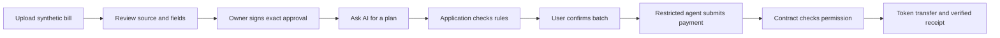

# Mandate

**ChainSentinel · International Track · Topic F — Agent Wallet**
**Updated 19 October 2026. Core prototype and Step 5 evidence complete; Step 6 has not started.**

[Project status](PROGRESS.md) · [Evidence index](evidence/README.md) · [Reviewer guide](SUBMISSION.md) · [Automated checks](https://github.com/arifshekhk8/chainsentinel-mandate/actions/workflows/checks.yml)

## What we built

Mandate is a working prototype for a small business that pays supplier invoices. The owner reviews the bills and grants exact, limited permission. An AI assistant helps interpret requests and suggest fields; a separate payment agent executes eligible bills. A smart contract checks the owner's permission before every transfer.

The project uses fictional **Orbit Studio**, synthetic invoices and **MDT test tokens with no cash value**. It supports a disposable local blockchain and Ethereum Sepolia. It is a competition prototype, with the limitations below; it is not a production service for real business funds.

The useful workflow is: review a batch once, then let a restricted agent handle the approved payments and explain why other bills must wait. We have not measured human time savings or real customer adoption.

## How a bill becomes a payment



1. **Import.** Upload CSV or a text-based PDF, up to 5 MB. CSV parsing creates deterministic draft records. Optional AI field assistance proposes fields for a single invoice; uncertain values need review. Scanned-image OCR is outside this version.
2. **Review.** Compare the source text with invoice number, vendor, amount, currency and dates. Recipient addresses come from the owner's vendor registry. Editing a draft clears its review stamp.
3. **Approve.** The owner signs a batch containing exact bill keys, recipients, amounts, document hashes and payment windows. Approval sets permission; it does not transfer tokens. Changing a draft cannot change the existing signed approval.
4. **Request.** Ask a question, clarify a bill, propose a correction or request payment. Read-only questions and unresolved requests cannot execute. A payment request produces a plan and requires a separate confirmation.
5. **Plan.** Ordinary application code uses exact integer token units, current chain state and owner priorities. It checks per-bill limits, daily budget, reserve, vendor approval and access/payment windows. The model does not calculate balances or decide whether contract rules pass.
6. **Execute.** After the user checks the exact plan, the restricted agent signs only `payBill(billKey, policyVersion)` for the pinned vault. The contract reads recipient and amount from the approved bill and checks the rules again.
7. **Verify.** A bill is confirmed only when a successful receipt and matching payment event identify its exact bill, token, recipient and amount. Pending, unknown and reverted results remain distinct. Recovery checks the original hash; it does not blindly send again.
8. **Stop.** The owner can pause payments, cancel an unpaid approval or revoke the agent. The app waits for chain confirmation. Confirmed permission changes invalidate stale plans.

## Who controls what

| Component | Job | Authority |
| --- | --- | --- |
| Owner / MetaMask | Review vendors, bills, limits and access; sign approvals and stops | Sole authority to create or change permissions; owner key stays in the wallet |
| AI assistant / Groq | Suggest fields, interpret requests, ask for missing details | Produces validated proposals; cannot approve bills, change rules or create arbitrary transactions |
| Planner and executor | Calculate eligibility, order bills, submit fixed payment calls and reconcile receipts | Restricted agent key; current permissions and separate execution confirmation still apply |
| Mandate vault | Hold MDT, store exact approvals, enforce limits and transfer tokens | Independent on-chain checks before every payment |
| Local database | Preserve source text, drafts, reviews, plans and original transaction references | Cannot grant on-chain permission by changing a database flag |

The AI and payment agent are different parts. The AI interprets the request. The executor signs a narrowly defined transaction. The contract decides whether that transaction is permitted. Invoice text is untrusted data throughout this process.

## What the completed demonstration proved

Rules: **250 MDT per bill**, **400 MDT per UTC day**, **300 MDT minimum reserve**, expiring access for a separate agent. MDT has six decimal places; calculations use integers, so 200 MDT is 200,000,000 units.

| Bill | Amount | Verified Sepolia outcome |
| --- | --- | --- |
| HOST-1001 | 200 MDT | Paid to its exact approved Hostline recipient |
| ART-2001 | 150 MDT | Paid to its exact approved Artline recipient |
| HOST-1002 | 75 MDT | Unpaid; adding it would make daily spending 425 MDT, above 400 |

The vault started with 1,000 MDT and now holds **650 MDT**. Daily spent was **350 MDT**, leaving **50 MDT** at the recorded checkpoint. The owner then revoked the agent: agent address and access window are zero at policy version **7**. The agent retains unused gas funding but has no vault authority.

[The public report](evidence/STEP5_SEPOLIA_RESULTS.md) indexes all **13 original transactions**: 11 owner transactions, including one failed first deposit, and two exact agent payments. Read-only calls rejected duplicate payment, daily-limit excess and the former agent. These rejection calls are simulations and spent no gas. The later revoked-agent call used a bill that also exceeded the remaining daily limit; a clean otherwise-eligible revocation case is established separately by local tests.

The separate [Groq v5 fixed-case regression](evidence/STEP5_GROQ_RESULTS.md) measured all 40 cases: 19/20 ordinary tasks, 20/20 exception explanations, 156/156 exact fields, all six interaction cases and zero wrong transfers. All 27 claimed local payment receipts were checked. Repairs used observed failures, so this is not untouched held-out accuracy. Public observations and local results are separate evidence.

## Open the owner-review app

Use Node.js **22.18 or later** and npm; local/CI checks use **Node 25.2.1**. Access is required to clone the private repository.

```sh
git clone https://github.com/arifshekhk8/chainsentinel-mandate.git
cd chainsentinel-mandate
npm ci
npm run build
npm run dev
```

For an existing checkout, reinstall only when dependencies change. `npm run dev` builds the UI, starts a fresh disposable chain **31337** at `http://127.0.0.1:8545`, and serves the app at **http://127.0.0.1:4173**. Ctrl+C stops its services. Each fresh local launch has a new chain/session and in-memory agent; saved drafts do not make old local approvals current.

For local browser signing with your existing public owner address, stop the local app and run:

```sh
npm run dev -- --owner YOUR_PUBLIC_ADDRESS
```

Select a local wallet network with RPC `http://127.0.0.1:8545`, chain ID `31337`, symbol `ETH`. The local setup temporarily impersonates that public address to seed the disposable scenario, then stops impersonation before the app opens. This does not prove public owner authentication. Never supply an owner key to the application.

## Review and run the payment agent

1. Click **Try three sample bills**, or upload a supported file.
2. Open each **Review**, compare source and fields, then **Mark reviewed**.
3. Select the bills, use **Review approval**, check exact details and sign in the owner wallet.
4. Use **Rules & access → Review resume** and sign that separate action. A fresh vault starts paused.
5. Return to **Bills** and ask **“Pay all approved bills within my rules.”** With AI unconfigured, **Preview without AI** provides an explicitly labeled scripted manual plan.
6. Review recipients, amounts, blocked reasons and next actions. Check the execution confirmation and click **Run approved batch** once.
7. Read confirmed receipts below the plan and updated balances. After uncertainty, use **Recheck original payment hash** rather than sending again.

The UI has four work areas: **Bills**, **Vendors**, **Rules & access**, and **Activity**. Wallet approval and final batch confirmation are separate actions. An already-approved batch does not require another owner signature per payment.

For live AI, copy [.env.example](.env.example) to an ignored `.env`, choose `AI_PROVIDER=groq` with a private `GROQ_API_KEY`, and restart. The selected Groq model is `openai/gpt-oss-120b`. Gemini's earlier `gemini-3.8-flash` adapter is retained; optional OpenAI Responses support is also present. There is no automatic provider/model fallback or billing change. Keys remain on the backend. Only synthetic data should be sent to a provider.

## Sepolia setup and public evidence

The existing verified deployment and private data are preserved. `npm run sepolia` opens its persistent owner workspace at `http://127.0.0.1:4173`. The agent is currently revoked. Opening the app does not request AI or send a transaction; any future grant/payment demonstration needs explicit owner authorization.

A fresh deployment starts in review-only mode:

```sh
npm run build
npm run sepolia:setup -- --owner YOUR_PUBLIC_ADDRESS
```

Review at `http://127.0.0.1:4174`. After explicit sending authorization, stop that review process and run `npm run sepolia:setup -- --allow-wallet`. Preserve the original seed/database. Seven owner-confirmed actions deploy MDT/vault, deposit 1,000 MDT, register two fictional vendors, grant restricted access and fund the agent with 0.00005 Sepolia ETH. Bills and Resume require separate owner actions.

The current demo was authorized within a hard **0.001 Sepolia ETH** owner-outflow cap, including agent funding, with a **0.05 gwei** fee ceiling. Final measured owner outflow was **0.00005000032971641 ETH**; most is unused agent funding, not burned gas. Conservative reservations and all failed/wrapped attempts remain in the report. No automatic fee increase, replacement or blind retry occurs. Public receipts need two confirmations; these are not absolute finality.

Stop the persistent app before running `npm run sepolia:export`. Its raw export keeps the CLI's original extension-test flag false; actual user MetaMask owner operations and their specific compatibility limits are documented separately in the public report. Saved artifacts have been grouped under `evidence/`; historical embedded paths resolve through [the relocation map](evidence/locations.json).

## Run checks and the contract demonstration

```sh
npm run check:repo
npm run build
npm run format:check
npm test
npm run test:identity
npm run test:app
npm run test:agent
npm run test:evaluation
npm run test:sepolia
npm run build:app
npm run test:ui
```

These suites use disposable local chains and mock model transports, without live API calls or public spending. Browser tests use isolated headless Chrome, never the existing wallet profile. CI installs isolated Chromium. Live model commands are separate, excluded from CI and should not be used to repeat finished measurements casually.

`npm run demo:local` produces a scripted local contract demonstration, without AI. Tests/demo commands can write fresh artifacts at their original output paths; curated historical evidence lives in the grouped folders. The full maintenance review runs tests in an isolated public-source copy so it cannot overwrite saved receipts/screenshots or access the current private database.

[GitHub Actions](.github/workflows/checks.yml) checks repository hygiene, build/formatting, contracts, identity, owner workflow, agent/recovery, evaluator, local Sepolia rehearsal and browser flows. Use the actual run status. Local suite totals overlap earlier reports; do not add repeated regressions as independent cases.

## Known limits and remaining work

- The public approved-total question received an eligible-payment preview: 350 MDT instead of the requested 425 MDT approved total. Safety held, but the answer was incomplete. This remains documented.
- Local case N13 unnecessarily asked another question about an already-paid bill. It is retained as the one ordinary completion miss.
- MetaMask protected wrappers required two specific manual original-hash audits. Automatic exact transaction checks were not weakened; this is not universal wallet compatibility.
- The public revoked-state simulation overlaps a daily-limit failure. Its decoded error is `OnlyAgent`; clean otherwise-eligible stop testing is separate local evidence.
- CSV and text PDFs are supported; scanned OCR, mainnet, real funds, multiple businesses and production authentication/key management are outside this prototype. The private agent key uses file permissions, not encryption.
- Organizer acknowledgment, acceptance of Sepolia evidence and final delivery instructions remain unresolved. Registration was verified sent; final project submission has not happened.

**Step 6 is later:** the technical report, security self-assessment, English slide deck, demo video and final delivery package. No Step 6 artifact is being created in this maintenance task.

## Folder map

| Location | Purpose |
| --- | --- |
| Root Markdown files | This guide, reviewer guide and seven working documents; current status is in [PROGRESS.md](PROGRESS.md) |
| [app/](app/) | Intake, SQLite drafts, AI adapter, planner, executor, owner API and browser UI |
| [contracts/](contracts/) | MDT token, permission-enforcing vault and test-network guard |
| [scripts/](scripts/) | Build, local setup, evaluation, Sepolia setup/app/export |
| [test/](test/) | Solidity, Node and isolated browser checks |
| [demo/](demo/) | Accepted scenario, 40 fixed cases and original evaluation freezes |
| [competition/](competition/) | Original blank organizer files and source/registration notes |
| [evidence/](evidence/) | [Reports, grouped artifacts and provenance index](evidence/README.md) |
| [.github/](.github/) | Pinned CI workflow and review template |
| `local-data/`, `.env` | Private ignored drafts, databases, agent key and local configuration; preserve them |
| `node_modules/` | Installed dependencies; ignored and retained |
| `dist/`, `out/`, `cache/` | Generated app/contract output; ignored; the running app currently needs `dist/` |

## Implemented files

| File | Responsibility |
| --- | --- |
| [intake.mjs](app/intake.mjs) | Bounded CSV/text-PDF parsing and draft fields |
| [service.mjs](app/service.mjs) | Source review, vendor/approval assessment and exact owner transaction preparation |
| [model.mjs](app/model.mjs), [agent.mjs](app/agent.mjs) | Structured AI proposals, conversation guards and draft correction |
| [planner.mjs](app/planner.mjs) | Exact integer eligibility, order, reasons and projected balances |
| [executor.mjs](app/executor.mjs) | Fixed signing route, durable queue, simulation and receipt recovery |
| [MandateVault.sol](contracts/MandateVault.sol) | On-chain authority, limits, reserve, paid markers and stop controls |
| [MandateDemoToken.sol](contracts/MandateDemoToken.sol) | Fixed-supply six-decimal test token |
| [sepolia.mjs](scripts/sepolia.mjs) | Review-only setup, persistent owner app and evidence export |

## Planning and competition documents

[PROJECT_PLAN.md](PROJECT_PLAN.md) defines scope/steps; [REQUIREMENTS.md](REQUIREMENTS.md) defines acceptance; [ARCHITECTURE.md](ARCHITECTURE.md) explains implementation; [SECURITY.md](SECURITY.md) records safeguards and limits; [TESTING.md](TESTING.md) indexes checks; [PROGRESS.md](PROGRESS.md) is the current handoff; [AGENTS.md](AGENTS.md) governs workspace work. [SUBMISSION.md](SUBMISSION.md) is the reviewer/package checklist.

The dated [competition notes](competition/requirements.md) preserve the source rules and deadline: **20 October 2026, 21:59 Bangladesh**. They do not establish acknowledgment or testnet acceptance. Completed registration/identity documents stay private and excluded from Git; the tracked workbook is the original blank form.

## Pinned tools and third-party sources

| Dependency | Version / license | Official source |
| --- | --- | --- |
| Foundry Forge and Anvil | 1.7.1 / MIT or Apache-2.0 | [Foundry installation](https://getfoundry.sh/getting-started/installation), [npm source](https://github.com/foundry-rs/foundry/tree/master/npm) |
| Solidity compiler | 0.8.37 / GPL-3.0 | [Release](https://www.soliditylang.org/blog/2026/09/10/solidity-0.8.37-release-announcement/) |
| OpenZeppelin Contracts | 5.6.1 / MIT | [ERC-20/SafeERC20](https://docs.openzeppelin.com/contracts/5.x/api/token/erc20), [ReentrancyGuard](https://docs.openzeppelin.com/contracts/5.x/api/utils#ReentrancyGuard) |
| ethers | 6.17.0 / MIT | [Contract API](https://docs.ethers.org/v6/api/contract/), [JSON-RPC provider](https://docs.ethers.org/v6/api/providers/jsonrpc/) |
| esbuild | 0.28.2 / MIT | [Build API](https://esbuild.github.io/api/) |
| csv-parse | 7.0.3 / MIT | [Parser options](https://csv.js.org/parse/options/) |
| PDF.js / pdfjs-dist | 6.4.299 / Apache-2.0 | [Text extraction API](https://mozilla.github.io/pdf.js/api/draft/module-pdfjsLib.html) |
| pdf-lib | 1.17.1 / MIT | [PDFDocument API](https://pdf-lib.js.org/docs/api/classes/pdfdocument) — synthetic sample/test invoices |
| Playwright Test | 1.64.1 / Apache-2.0 | [Browser contexts](https://playwright.dev/docs/api/class-browsercontext) |

SQLite uses [Node's built-in API](https://nodejs.org/download/release/v25.1.0/docs/api/sqlite.html); it is not a separate npm dependency. The frontend uses plain ES modules/HTML/CSS to keep this prototype small; no React framework or remote scripts/fonts are required.

AI uses native Node fetch with no extra SDK: Gemini Interactions REST (`v1beta`, `gemini-3.8-flash`), Groq Chat Completions (`v1`, `openai/gpt-oss-120b`) or optional OpenAI Responses. Gemini/OpenAI request `store:false`. Groq Chat Completions does not support that field; its stateless requests use strict schema, low reasoning with reasoning output disabled, temperature 0.2 and a 2,000-token cap. This does not erase provider retention obligations. Use only synthetic data. See [Groq structured outputs](https://console.groq.com/docs/structured-outputs), [reasoning](https://console.groq.com/docs/reasoning), [data policy](https://console.groq.com/docs/your-data), [Gemini retention](https://ai.google.dev/gemini-api/docs/interactions-overview#data-storage-and-retention), [Gemini data use](https://ai.google.dev/gemini-api/docs/pricing) and [OpenAI data controls](https://developers.openai.com/api/docs/guides/your-data). Transaction preparation/signing follows [ethers Signer](https://docs.ethers.org/v6/api/providers/#Signer) and [Wallet](https://docs.ethers.org/v6/api/wallet/) APIs.

Exact npm versions and integrity hashes are in [package-lock.json](package-lock.json). Foundry's native packages are installed inside node_modules; no shell configuration was changed. Compiler binaries use Foundry's normal user cache. Dependency licenses remain with their installed packages. All invoices and test businesses are synthetic; no external dataset is included.

CI additionally uses the official [checkout v7.0.1](https://github.com/actions/checkout/releases/tag/v7.0.1) and [setup-node v7.1.0](https://github.com/actions/setup-node/releases/tag/v7.1.0) actions at the immutable hashes recorded in the workflow. Organizer documents remain unchanged and their original source links are recorded in [competition/requirements.md](competition/requirements.md).
